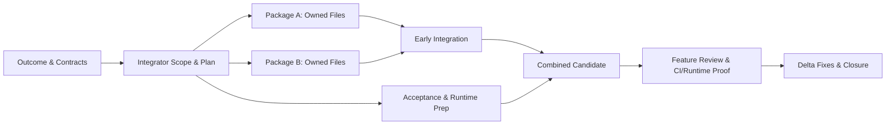

# High-Efficiency Feature Development

High-Efficiency Feature Development is a portable orchestration workflow for multi-agent software delivery. It structures end-to-end feature execution around clear interface contracts, disciplined concurrency, unified integration, and real-boundary verification—turning fragmented agent output into complete, operable software.

## The Challenge

Parallel agents can generate work faster than integration capacity, and this can shift the bottleneck from implementation to verification. When the volume of incoming patches exceeds the speed of review and end-to-end validation, repeated setup, redundant code analysis, and lost context consume valuable time and tokens, potentially hindering the project’s overall velocity rather than accelerating it.

## Field Observations

When multi-agent delivery stalls near the finish line, five failure patterns typically appear:

- **Micro-PR and helper-level fragmentation:** Splitting a single feature into isolated helper or sub-component pull requests multiplies review overhead while hiding end-to-end behavior.
- **Lost cross-boundary context:** Independent workers make incompatible assumptions across pages, APIs, state transitions, or persistence layers.
- **Duplicate reviews on shifting candidates:** Running full-scope audits repeatedly before underlying branches stabilize wastes context and produces contradictory feedback.
- **Green mocks without an operable flow:** Unit suites pass against synthetic stubs while the assembled application fails on real state transitions or persistence.
- **Integration and merge queues:** Completed fragments sit waiting for conflict resolution, rebasing, and combined verification while new branches continue to open.

In this workflow, progress is not measured by open branches, isolated diffs, or mocked test counts. Progress means an operable complete flow verified through authoritative read-back across the relevant system boundaries. Conversely, isolated low-impact fixes should go straight to implementation and verification without multi-package ceremony.

## Pipeline Architecture

The workflow separates internal execution parallelism from integration and review boundaries.



### 1. Outcome Definition and Single Integrator Ownership
Work begins by inspecting existing architecture, contracts, and local repository rules to define the complete user outcome and acceptance chain. A single integrator owns scope, interface definitions, dependency order, early integration, verification evidence, and final closure.

### 2. Execution Packages vs. Delivery Boundaries
Parallel work packages are internal execution units, not automatic pull-request boundaries. Parallelizing work requires stable interfaces and strictly nonoverlapping owned files. If boundaries are still shifting, work stays sequential until contracts settle.

### 3. Capacity-Aware Scheduling and Worker Reuse
The integrator maintains adaptive scheduling preferences informed by bottlenecks, readiness, risk, and capacity. Prioritize critical path unblocking, integration defects, and acceptance or closure tasks—but blocked urgent work must not prevent useful, independent parallel progress. Concurrency tracks actual reviewer and runtime capacity; workers are never spawned merely to fill slots. Context-carrying workers are reused across related follow-ups rather than replaced with fresh duplicate audits or noisy status polling.

### 4. Shared Runtime Discipline and Pipelining
Isolated unit and contract checks may run concurrently inside individual packages. However, any shared runtime environment—such as an application server, database, simulator, or seeded test environment—has a single owner responsible for lifecycle, configuration, test data, and recovery. Focused tests, CI checks, and acceptance preparation are pipelined as soon as dependencies permit. CI and actual independent runtime acceptance can overlap with the Feature Review, not just preparation.

## Feature Review

Instead of reviewing disconnected micro-diffs or re-auditing unstable branches, the workflow conducts one full Feature Review once the combined candidate is assembled and internally coherent:

- **Full-context inspection:** The reviewer evaluates the complete user journey, interface contracts, combined diff, and verification evidence together. Review focuses on concrete maintainability and code necessity—such as identifying unnecessary code, duplication, excessive abstraction, or coupling/boundary violations—without performing style-only churn.
- **Consolidated actionable findings:** Feedback is grouped into concrete defects stating exact trigger conditions and user or system impact.
- **Targeted delta verification:** After fixes land, the same reviewer inspects the fix delta and its integration impact. A full review restart occurs only when scope or behavior changes materially, or when local mandatory gates require one.

## Integration and Acceptance Evidence

A feature reaches closure only when proven across the real boundaries appropriate to the change, confirming an operable flow with authoritative read-back from the backing state or interface. Verification records keep evidence categories explicitly distinct:

- **Unit evidence:** Fast logic and edge-case checks in isolation.
- **Integration evidence:** Real module, service, storage, or API contract interaction.
- **CI evidence:** Automated repository build, lint, type, and regression gates.
- **Browser or device evidence:** Real UI rendering, navigation, and interaction proof, selected from the affected user journey. Backend changes affecting clients may require client acceptance, but isolated non-UI behavior does not require UI tests.

## Portability and Host Governance

This repository provides a portable coordination layer without hardcoding project names, local paths, API hosts, credentials, model routing, fixed worker counts, numeric PR caps, branch policies, or stack-specific rules. At runtime, user instructions and the host repository's `AGENTS.md`, architecture docs, runtime procedures, contribution guidelines, permissions, and mandatory merge gates always take precedence.

### Repository Contents

- `skills/feature-development-pipeline/SKILL.md` — Core workflow entry point, triage rules, and decision guardrails.
- `skills/feature-development-pipeline/references/work-package-orchestration.md` — Detailed guidance on file ownership, scheduling priorities, worker reuse, and shared-runtime control.
- `skills/feature-development-pipeline/references/integration-and-acceptance.md` — Rules for early code integration, consolidated Feature Review, delta re-review, and boundary-appropriate test design and evidence.

## Installation and Usage

Clone this repository and link or copy the nested skill directory into your local Codex skills path:

```bash
git clone https://github.com/miles-song/high-efficiency-feature-development.git
mkdir -p ~/.codex/skills
ln -s "$(pwd)/high-efficiency-feature-development/skills/feature-development-pipeline" ~/.codex/skills/feature-development-pipeline
```

If you prefer a standalone copy instead of a symlink, run `cp -R` with the same source and destination paths.

Invoke the workflow in Codex by referencing `$feature-development-pipeline` in your prompt when planning or executing multi-step features. Leave `$feature-development-pipeline` uninvoked for small, single-file, low-risk fixes where direct execution is faster and clearer.

## Iterating on the Workflow

Refine this workflow only through narrow, targeted adjustments backed by observed delivery bottlenecks or escaped late-stage defects. Avoid accumulating speculative checklists, rigid ceremony, or parallel status-tracking bureaucracy, and evaluate changes against actual integration smoothness and defect discovery.

## Optional Supplementary References

Teams looking for standalone guidance on general code review heuristics or test-case design techniques may consult these external skills (linked for optional reference only; neither is bundled nor required by this workflow):

- [Sentry Code Review Skill](https://github.com/getsentry/skills/blob/c2f99a5b04b4cd992ec3022d7c2c3e23e938d241/skills/code-review/SKILL.md)
- [Testified Test Case Design Skill](https://github.com/testified-oss/agent-skills/blob/dce83769bc5d45b2150c1ac2e3c731db17830b29/skills/test-case-design/SKILL.md)

## License

Released under the [MIT License](LICENSE).
